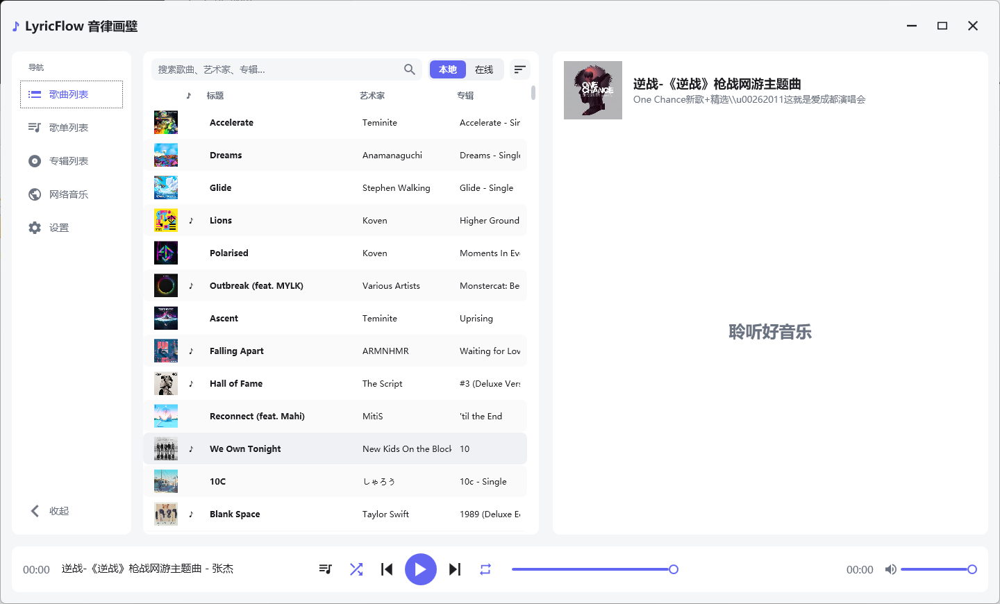
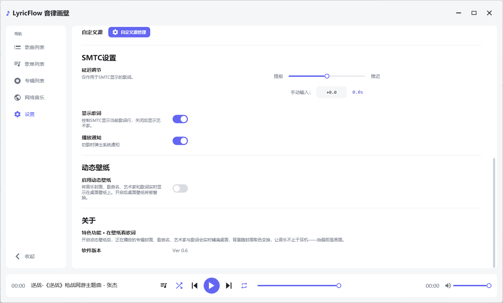

# LyricFlow 音律画壁 · 使用文档

> 版本：Ver 0.6
> 适用系统：Windows 10 / 11（64 位）
> 文档定位：面向使用者的操作说明，不含开发与二开内容。

---

## 1. 软件简介

LyricFlow 音律画壁是一款 Windows 桌面音乐播放器，特点是：

- 本地音乐库管理：按文件夹导入，自动扫描歌曲、同名歌词与专辑信息
- 网络音乐：通过自定义 JS 音源脚本接入各音乐平台，支持搜索与在线播放
- 逐字歌词：支持词级时间轴，播放时呈现 KTV 式逐字擦亮与轻微上浮
- 全屏歌词与歌词字号调节
- 系统集成：SMTC 媒体卡片歌词、切歌通知、全局媒体键
- 动态壁纸：把封面、歌名、歌手和歌词实时绘制到桌面

界面为浅色/深色双主题、无边框卡片式设计，可自定义强调色或用封面主色染色。

---

## 2. 启动与退出

### 2.1 启动

- 绿色版直接双击 `LyricFlow音律画壁.exe` 运行，无需安装。
- 首次启动没有任何音乐，需先添加本地文件夹，或导入网络音源。
- 启动时会自动扫描已添加的文件夹，并恢复上次关闭前的播放列表。
- **恢复会话不会自动播放**：列表、当前曲目、封面会恢复，按下播放键后才真正开始播放。

### 2.2 退出

- 点击右上角关闭按钮退出，退出前会保存当前播放队列与当前曲目。
- 最小化/最大化按钮为常规窗口行为。
- 退出时若正在使用动态壁纸，会自动恢复原桌面壁纸。

### 2.3 数据位置

所有设置与缓存均保存在当前用户目录，不写入安装目录：

| 路径                         | 内容                                                         |
| ---------------------------- | ------------------------------------------------------------ |
| `%LocalAppData%\MusicPlayer` | 界面设置、播放会话、已解析播放地址缓存、封面缓存、网络歌曲列表 |
| `%LocalAppData%\LyricFlow`   | 应用图标、切歌通知封面缓存                                   |

备份或迁移时，复制 `%LocalAppData%\MusicPlayer` 即可保留设置与列表。

---

## 3. 界面总览

### 3.1 左侧导航

| 导航项   | 作用                                                    |
| -------- | ------------------------------------------------------- |
| 歌曲列表 | 主页：左侧歌曲列表（本地/在线分页），右侧正在播放与歌词 |
| 歌单列表 | 管理自建歌单及其歌曲                                    |
| 专辑列表 | 按专辑自动聚合本地歌曲                                  |
| 网络音乐 | 搜索并播放在线歌曲                                      |
| 设置     | 外观、音乐库、自定义源、SMTC、播放通知、动态壁纸、关于  |

底部「收起/展开」按钮可折叠导航栏。

### 3.2 底部播放栏

从左到右依次为：

- 播放列表按钮：打开当前播放队列
- 随机播放按钮
- 上一首 / 播放暂停 / 下一首
- 循环模式按钮（每点一次在三态间切换）
- 进度条（可拖动跳转）
- 音量滑块

### 3.3 正在播放区

- 显示封面、歌曲名、歌手、专辑与歌词。
- 封面右上角有「全屏显示歌词」按钮，进入全屏歌词模式；全屏后点击「返回歌曲列表」退出。
- 网络歌曲播放时，底部标题处会显示解析/换源等状态。

---

## 4. 导入与管理本地音乐

### 4.1 添加文件夹

1. 打开「设置 → 音乐库」。
2. 点击「添加文件夹」，选择一个或多个包含音乐的目录。
3. 软件自动扫描并建立歌曲列表，扫描期间显示四点加载动画。

说明：

- 支持格式：`.mp3`、`.m4a`、`.aac`、`.flac`、`.wav`、`.wma`、`.3gp`、`.3g2`、`.adt`、`.asf`。
- 歌词文件放在歌曲同目录、与歌曲同名即可（`.lrc` 或 `.lrcx`）。
- 歌曲封面优先读取文件内嵌封面；无内嵌封面时显示占位图。
- 移除文件夹只从音乐库移除，**不会删除本地文件**；重新添加会重新扫描。

### 4.2 歌曲列表（本地分页）

- 顶部搜索框可按歌曲名、艺术家、专辑即时过滤。
- 排序按钮支持：默认顺序、按歌曲名、按艺术家、按专辑、按时长。
- 双击歌曲开始播放；当前播放行有高亮标记。
- 右键歌曲可选择「插播」（把该曲设为下一首）。
- 列表「♪」列表示该曲已找到歌词。

### 4.3 在线分页

歌曲列表右上角可切换「本地 / 在线」：

- 本地：本地音乐库。
- 在线：曾经播放过的网络歌曲，会持久保存，重启后仍在。
- 在线分页的右键菜单额外提供「删除」，仅从网络列表移除；若删除的是当前曲目会停止播放。

### 4.4 歌单

1. 进入「歌单列表」，点击右上角「新建歌单」。
2. 输入歌单名称，选择来源文件夹，按 Ctrl / Shift 多选歌曲，点击「创建」。
3. 左侧歌单支持「刷新」（重新扫描该文件夹中新增的歌曲和歌词）与「删除」。
4. 删除歌单只删除歌单本身，不影响本地文件；歌单歌曲右键仅提供「插播」。

### 4.5 专辑

「专辑列表」会按专辑名自动聚合本地歌曲：

- 点击专辑进入该专辑歌曲列表，双击歌曲播放。
- 点击「返回专辑列表」回到聚合视图。

---

## 5. 网络音乐

网络音乐以第三方 JS 音源脚本为主，软件同时内置了五个平台的公开接口兜底，用于搜索、歌词、封面以及部分平台的播放直链。

### 5.1 导入音源

1. 打开「设置 → 自定义源」。
2. 点击「自定义源管理」。
3. 选择「导入 JS 文件」导入本地脚本，或点击右侧链接图标从 URL 导入。
4. 导入成功后列表会显示源数量与平台信息；可随时移除某个源。
5. 在弹窗下方选择「音源」和「平台」。

说明：

- 未选择平台时，会在该音源的所有平台中搜索。
- 未选择音源时，会并行搜索所有已加载音源的全部平台。
- 若脚本没有声明支持的平台，软件会自动补全平台，方便直接使用。
- 搜索、歌词、封面都带有平台级公开接口兜底：脚本失效时仍可能搜到结果，但直链能否播放取决于平台与歌曲版权。
- 脚本运行在隔离沙箱中，单次请求有超时限制；请只导入可信来源的脚本。
- 音源脚本失效时，搜索状态区会以红色提示；此时多平台搜索仍会尝试公开接口，建议同时更新脚本。

### 5.2 搜索与播放

1. 进入「网络音乐」页面。
2. 输入歌名或歌手关键词，点击「搜索」或按回车。
3. 各平台结果会边搜边追加；状态栏显示当前搜索进度与结果数量。
4. 双击某条结果：自动加入「在线」分页并开始播放，页面切换到歌曲列表。
5. 网络歌曲封面会按高清规格缓存；全屏播放时使用更大尺寸封面。

搜索速度说明：

- 脚本搜索单独限时 12 秒，超时后立即交给公开接口兜底，不会长时间卡住（播放解析仍为 20 秒）。
- 后端备用域名改为并行竞速，谁先返回有效结果就用谁，避免逐个尝试造成的叠加等待。
- 搜索策略链为：脚本搜索 → 平台公开接口 → 后端约定接口。

:::important[免责声明]
第三方音源脚本与各平台内容版权归其权利人所有，请仅在个人合法范围内使用。
:::

---

## 6. 播放控制与快捷键

### 6.1 快捷键

| 操作         | 快捷键                                        |
| ------------ | --------------------------------------------- |
| 播放 / 暂停  | `空格`（输入框内不生效）                      |
| 上一首       | `Ctrl + Q`                                    |
| 下一首       | `Ctrl + E`                                    |
| 音量 +       | `Ctrl + ↑`（每次 5%）                         |
| 音量 −       | `Ctrl + ↓`（每次 5%）                         |
| 随机播放开关 | `Ctrl + S`                                    |
| 循环模式切换 | `Ctrl + R`                                    |
| 系统媒体键   | 播放/暂停、上一首、下一首（窗口失焦时也生效） |

### 6.2 随机与循环

- 随机开启后，当前曲目固定在列表首位，其余歌曲按随机序列展开，切歌按该序列进行，不会漏歌。
- 循环按钮三态循环：不循环 → 列表循环 → 单曲循环。
- 随机与循环状态会被记住，下次启动自动还原。

### 6.3 播放队列与插播

- 点击底部「播放列表」按钮查看当前队列、曲目数量与当前播放位置。
- 在任意歌曲列表右键「插播」，该曲会排在当前曲目之后立即播放。

### 6.4 会话恢复

- 关闭软件时保存播放队列与当前曲目。
- 下次启动恢复列表与当前曲目显示，但不自动发声。
- 已失效的临时直链不会写入会话；已删除的本地文件会自动跳过。
- 上次的网络搜索关键词与结果也会一并恢复。

---

## 7. 歌词

### 7.1 歌词来源

- 本地歌曲：优先读取同目录同名 `.lrc` / `.lrcx`；找不到时按歌名在库目录中查找。
- 网络歌曲：优先使用音源脚本返回的歌词，支持普通歌词、翻译歌词与词级增强歌词；脚本未返回时由平台公开接口兜底获取。
- 中英翻译会按时间轴合并，逐行显示。

### 7.2 逐字歌词

当歌词包含词级时间信息（`.lrcx` 或音源返回 `lxlyric` 等字段）时：

- 已唱部分按词从左到右擦亮，正在唱的词轻微上浮，唱完保持亮色。
- 相邻句时间重叠时采用「抢唱」逻辑：新句开始不抢当前焦点行，当前句唱完才切换到下一句，滚动平滑掠过中间重叠行。
- 没有词级数据的歌词自动退化为整行高亮，不影响使用。

### 7.3 歌词交互

- 单击某句歌词：跳转到该句时间点。
- 按住上下拖动：临时浏览其他歌词，松手后自动回到当前播放行。
- 鼠标滚轮不滚动歌词，避免误操作。
- 封面右上角按钮进入全屏歌词；全屏下同样支持点击跳转与拖动浏览。

### 7.4 字号

- 「设置 → 外观 → 歌词大小」可调 18–40 px（默认 27），拖动即时预览。
- 行高、句间距与可视行数会随字号等比调整，设置自动保存。

---

## 8. 系统集成

### 8.1 SMTC 媒体卡片

- 播放时系统媒体卡片（音量浮层、锁屏）显示歌曲信息。
- 「设置 → SMTC设置 → 显示歌词」：开启时媒体卡片显示当前歌词行；关闭时显示艺术家。
- 「歌词延迟」可调 −5 ~ +5 秒（步长 0.1），仅影响 SMTC 显示的歌词，不改变软件内歌词同步。

### 8.2 播放通知

- 「设置 → SMTC设置 → 播放通知」控制切歌时是否弹出系统通知。
- 通知包含封面、歌名与歌手；同一首歌 15 秒内重复触发只显示一次。
- 上一首/下一首、双击歌曲、自动续播都会触发。
- 若系统关闭了该应用的通知权限，通知不会显示，需在 Windows 通知设置中允许。

### 8.3 动态壁纸

- 「设置 → 动态壁纸 → 启用动态壁纸」开启后，桌面壁纸会被替换为实时画面。
- 画面包含当前封面、歌名、歌手与歌词，背景随封面取色渐变。
- 关闭开关或退出软件时恢复原壁纸。
- 画面按主显示器尺寸绘制，多显示器环境下仅覆盖主屏。

### 8.4 全局媒体键

软件注册了系统媒体键：即使窗口在后台，键盘/耳机上的播放暂停、上一首、下一首也能控制播放。

---

## 9. 外观设置

| 设置项       | 说明                                                         |
| ------------ | ------------------------------------------------------------ |
| 主题         | 浅色 / 深色，切换立即生效并保存                              |
| 强调色       | 8 种预设色 + 自定义十六进制（如 `#6366F1`）                  |
| 封面主色染色 | 用当前封面主色给背景与卡片柔和染色。开启后强调色自动由封面次要色接管：从封面 32×32 缩略图采样，过滤低饱和、近黑近白及与主色过近的像素后取最合适的颜色；取不到时回退到你自定义的强调色。自定义颜色值始终保留，关闭染色后立即恢复可用 |
| 歌词大小     | 18–40 px，带即时预览                                         |

界面按钮、列表项、菜单等在鼠标悬停时有淡入淡出过渡；选中态、勾选态具有更高优先级，不会被悬停效果覆盖。

---

## 10. 常见问题

| 现象                               | 排查与解决                                                   |
| ---------------------------------- | ------------------------------------------------------------ |
| 网络音乐搜索提示「还没有可用音源」 | 先在「设置 → 自定义源」导入 JS 音源脚本；若脚本未声明平台，软件会自动补全五大平台 |
| 搜索很慢或长时间转圈               | 脚本搜索 12 秒超时会自动转交平台公开接口，后端备用域名并行竞速；若长期无结果，多为接口整体失效，建议更新音源脚本 |
| 切换平台后搜不到歌、没有封面或歌词 | 搜索/歌词/封面均有平台公开接口兜底；封面歌词在开播后异步补全，稍等或重新播放即可触发；仍为空可换平台 |
| 搜索有结果但播放失败               | 已按「脚本解析 → 平台直链兜底 → 后端直连」逐层尝试。仅免费歌曲、试听。版权/VIP 歌曲可能所有接口都失败，建议换平台或换音源 |
| 某首歌一直无法播放                 | 换一个音源/平台搜索同一首歌；或在「在线」分页删除该曲后重新播放 |
| 网络歌曲没有封面或封面模糊         | 首次播放会异步补全并缓存高清封面（优先官方专辑封面，其余平台走公开接口）；可稍等或重新播放触发下载 |
| 歌词不显示                         | 确认本地有同名 `.lrc`/`.lrcx`；网络歌曲先由音源脚本返回、失败后由平台公开接口兜底；仍为空时检查歌词编码是否为 UTF-8 |
| 逐字效果没有出现                   | 该歌词只有整行时间轴；需要 `.lrcx` 或音源提供 `lxlyric` 等词级数据 |
| 歌词与歌声不同步                   | 若仅系统媒体卡片不同步，调「歌词延迟」；软件内歌词以文件时间轴为准，需修正歌词文件 |
| 切歌通知不弹出                     | 检查「播放通知」开关是否开启，以及 Windows 通知设置是否允许该应用 |
| SMTC 媒体卡片不显示歌词            | 检查「显示歌词」开关；确认已开启 SMTC 歌词且歌曲有歌词       |
| 动态壁纸没有变化                   | 确认已开启且未处于全屏独占应用；壁纸仅覆盖主显示器           |
| 关闭后壁纸未恢复                   | 重新开启再关闭一次动态壁纸；异常退出时可手动重设桌面壁纸     |
| 重启后播放列表变了                 | 会话只恢复可恢复的曲目：临时直链、已删除文件会被跳过；其余列表与当前曲目会恢复 |
| 移除文件夹后歌曲仍在               | 移除后需重新进入列表刷新，或重启软件；文件本身未被删除       |
| 开启封面染色后无法自定义强调色     | 属于正常联动：染色期间强调色由封面次要色接管，自定义入口禁用；关闭染色后立即恢复，原自定义值不会丢失 |
| 封面染色的颜色不理想               | 自动取色会过滤低饱和、近黑近白及与主色过近的像素，取不到时回退自定义强调色；可关闭染色改用固定强调色 |
| 界面字体/颜色异常                  | 「设置 → 外观」恢复浅色/深色与默认强调色；封面染色开启时会覆盖强调色 |

---

## 11. 版本信息

- 当前版本：Ver 0.6
- 版本号显示在「设置 → 关于」。
- 文档更新时间：2026-11-01。
- 数据备份：关闭软件后复制 `%LocalAppData%\MusicPlayer` 目录。
- 卸载：删除程序文件，并按需删除上述数据目录即可，不残留系统服务或驱动。